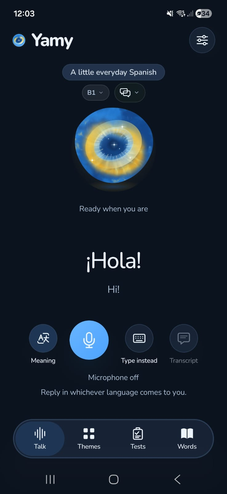
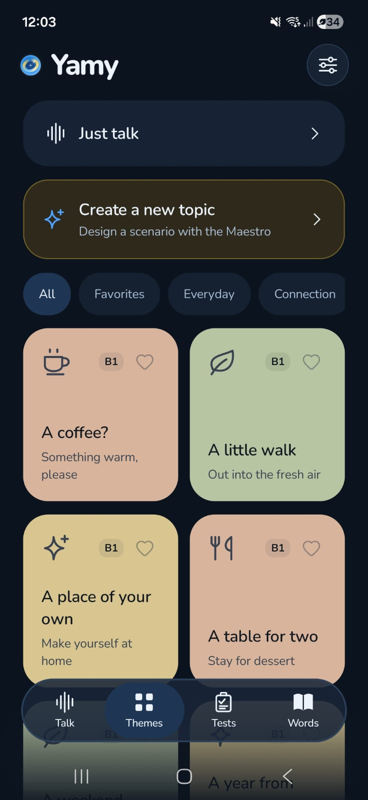
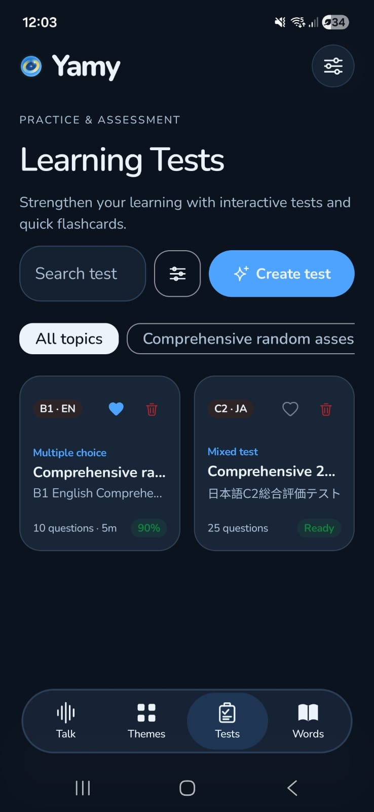
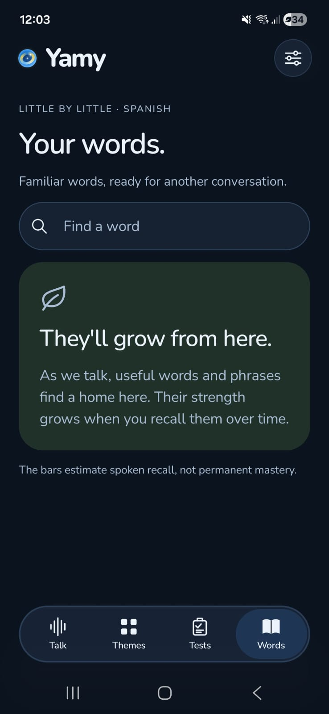
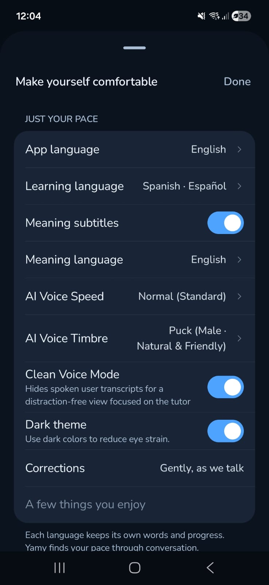

<div align="center">


# Yamy

**Tu asistente de aprendizaje de idiomas. Habla, escucha y aprende conversando.**

[-28A745?style=flat-square&logo=android&logoColor=white)](https://github.com/KelmerOC/Yamy/releases/tag/v0.1.03)
[](LICENSE)
[](docs/instalacion.md)
[](apps/android)
[](docs/arquitectura.md)
[](#idiomas)

[Descargar APK](https://github.com/KelmerOC/Yamy/releases/download/v0.1.03/yamy-v0.1.03.apk) · [Instalación](docs/instalacion.md) · [Manual de usuario](docs/manual-de-usuario.md) · [Arquitectura](docs/arquitectura.md) · [Créditos](#creditos)

</div>

---

## Qué es Yamy

**Yamy** es una aplicación nativa para aprender idiomas **mediante conversación oral**. Hablas con una esfera nebulosa animada que te escucha en tiempo real, te responde con voz natural y te ayuda con el significado justo cuando lo necesitas. Tus conversaciones, palabras y progreso se guardan **exclusivamente en tu dispositivo**.

<table>
  <tr>
    <td align="center" width="20%"><br /><b>Hablar</b><br /><sub>Conversación por voz con la esfera</sub></td>
    <td align="center" width="20%"><br /><b>Temas</b><br /><sub>Escenarios y temas propios</sub></td>
    <td align="center" width="20%"><br /><b>Tests</b><br /><sub>Evaluaciones de práctica</sub></td>
    <td align="center" width="20%"><br /><b>Palabras</b><br /><sub>Vocabulario con barras de recuerdo</sub></td>
    <td align="center" width="20%"><br /><b>Ajustes</b><br /><sub>Idiomas, voz y modos</sub></td>
  </tr>
</table>

## Funciones principales

| Función | Descripción |
| :--- | :--- |
| **Conversación oral en vivo** | Audio continuo a 16 kHz con `gemini-3.8-live`. La IA saluda primero y puedes hablar o escribir en cualquier momento ("Dilo a tu manera"). |
| **Significado al instante** | Subtítulos de significado en el idioma que elijas, con un toque. |
| **Temas y escenarios** | 24 escenarios cotidianos (café, mercado, viajes, vecinos, opiniones...) y creación de temas propios con el Maestro. |
| **Niveles MCER A1 a C2** | El ritmo, el vocabulario y la gramática se ajustan a tu nivel. |
| **Modo educación / conversación** | Microcorrecciones durante la charla o inmersión total con correcciones al final. |
| **Tests** | Opción múltiple, banco de palabras, comprensión lectora, corrección y expresión oral. |
| **Palabras** | Vocabulario recogido de tus conversaciones con barras de recuerdo. |
| **Privacidad** | Tu clave de API se cifra con Android Keystore; el historial vive en el teléfono y nunca incluye la clave en las copias. |

<a id="idiomas"></a>

## Idiomas

Español, English, Norsk (Bokmål), Français, Deutsch, Italiano, Português, 普通话 (Mandarín con pinyin), Runa Simi (Quechua Cusco-Collao), 한국어, 日本語 y हिन्दी.

## Descarga directa del APK

Puedes descargar la última versión oficial lista para instalar en tu dispositivo Android desde los lanzamientos del repositorio:

👉 **[Descargar Yamy v0.1.03 (APK)](https://github.com/KelmerOC/Yamy/releases/download/v0.1.03/yamy-v0.1.03.apk)** *(63.5 MB, Android 8.0 o superior)*

## Instalación rápida (Compilación desde fuente)

Necesitas JDK 17 o superior, Android SDK 36 y un teléfono con Android 8.0 o superior.

```sh
git clone https://github.com/KelmerOC/Yamy.git
cd Yamy/apps/android
./gradlew testDebugUnitTest
./gradlew assembleDebug
```

El APK se genera en `apps/android/app/build/outputs/apk/debug/app-debug.apk`. Instálalo en tu teléfono y, en **Ajustes > Cuenta de Google AI Studio**, guarda tu clave de API de Gemini (se obtiene gratis en [Google AI Studio](https://aistudio.google.com)).

La guía completa de instalación está en [docs/instalacion.md](docs/instalacion.md).

## Estructura del repositorio

```text
Yamy/
├── apps/
│   ├── android/        Aplicación nativa Android (Kotlin, Jetpack Compose)
│   └── ios/            Lógica y paquete Swift Core compartido (experimental)
├── services/
│   └── api/            Backend de Yamy (Node.js, TypeScript, Fastify, PostgreSQL)
├── shared/             Contratos JSON Schema y fixtures multiplataforma
├── scripts/            Utilidades de verificación y exportación de contenido
├── docs/               Documentación técnica, manual de usuario y capturas
├── AGENTS.md           Reglas de arquitectura, invariantes de voz y flujos de agentes
├── CONTRIBUTING.md     Guía de contribución, pruebas y estándares de código
├── LICENSE             Licencia MIT y créditos oficiales
├── README.md           Presentación general del proyecto
└── SECURITY.md         Política de seguridad y privacidad
```

## Documentación

- [Instalación](docs/instalacion.md): requisitos, compilación e instalación de la app y el backend.
- [Manual de usuario](docs/manual-de-usuario.md): cómo usar cada pestaña de Yamy.
- [Arquitectura](docs/arquitectura.md): componentes, modelos de IA y flujo de audio y datos.
- [Guía de Contribución](CONTRIBUTING.md): flujo de trabajo, pruebas y estándares de código.
- [Instrucciones de Agentes](AGENTS.md): reglas pedagógicas, invariantes de audio y arquitectura multiplataforma.
- [Seguridad](SECURITY.md): protección de credenciales y privacidad.

<a id="creditos"></a>

## Créditos

Yamy es una aplicación de código abierto **basada en Mural**, creada originalmente por **Hackmamba** y sus colaboradores originales bajo la licencia MIT. Yamy conserva el aviso de copyright original y reconoce a sus creadores originales el trabajo fundacional sobre el que se construye este proyecto. Más detalles en [docs/creditos.md](docs/creditos.md).

## Licencia

Distribuido bajo la [licencia MIT](LICENSE). Los componentes de terceros conservan sus propias licencias.
