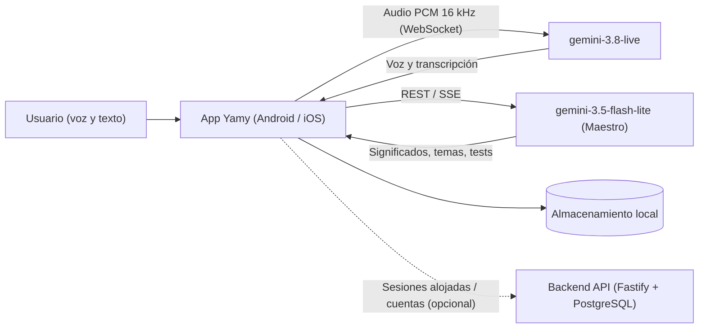

# Arquitectura de Yamy



## Componentes

| Carpeta | Tecnología | Responsabilidad |
| :--- | :--- | :--- |
| `apps/android` | Kotlin, Jetpack Compose, Coroutines/Flow, AudioRecord/AudioTrack, OkHttp WebSocket | Aplicación principal: conversación oral en vivo, temas, tests, palabras y ajustes. |
| `apps/ios` | Swift, SwiftUI, AVFoundation, URLSessionWebSocketTask | Cliente nativo iOS equivalente. |
| `services/api` | Node.js, TypeScript, Fastify, PostgreSQL | Backend opcional para cuentas gestionadas, facturación y sesiones alojadas. |
| `shared` | JSON Schema y JSON fixtures | Contratos y casos de prueba compartidos entre Android e iOS. |
| `scripts` | Python / Swift | Herramientas de sincronización de idiomas y verificación entre plataformas. |
| `docs` | Markdown | Manual de usuario, guía de instalación, arquitectura y créditos. |

## Modelos de IA

**Yamy** utiliza exclusivamente modelos Google Gemini:

- **Conversación en vivo** (`BidiGenerateContent` por WebSocket): `models/gemini-3.8-live`.
- **Maestro, significados y evaluaciones** (`generateContent` y SSE): `gemini-3.5-flash-lite`, con respaldo automático a `gemini-3.5-flash` y `gemini-3.8-flash` ante errores 404, 429 o 503.
- Las consultas al Maestro configuran `thinkingLevel: "low"` y `responseMimeType: "application/json"` en la creación de temas.

En modo personal (BYOK), la aplicación se conecta directamente a Google Gemini utilizando la clave personal del usuario sin requerir servidores intermediarios.

## Flujo de audio

1. Captura con `AudioRecord` en modo `VOICE_COMMUNICATION`: 16 000 Hz, mono, PCM de 16 bits.
2. Ganancia por software de `1.5f` con limitador suave a `32 000`.
3. Envío continuo mientras la llamada está activa. La detección de turnos conversacionales la realiza el VAD neuronal del servidor.
4. Cada trama se envía con formato dual (`audio` y `mediaChunks`) para compatibilidad universal.
5. Al iniciar la sesión, la IA saluda primero en el idioma practicado.
6. La conversación oral y la entrada escrita ("Dilo a tu manera") funcionan de manera simultánea.

## Datos y privacidad

- Conversaciones, vocabulario, tests y progreso: almacenamiento 100% local en el dispositivo.
- Clave de API: cifrada con Android Keystore (o Keychain en iOS); nunca se exporta.
- Copias de seguridad: archivo JSON local sin credenciales.

## Verificación

```sh
# Pruebas unitarias y compilación de Android
cd apps/android
./gradlew testDebugUnitTest
./gradlew assembleDebug

# Pruebas del backend API
cd ../../services/api
npm test
```
