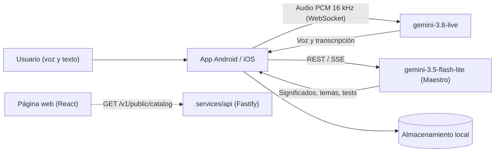

# Arquitectura



## Componentes

| Carpeta | Tecnología | Responsabilidad |
| :--- | :--- | :--- |
| `apps/android` | Kotlin, Jetpack Compose, Coroutines/Flow, AudioRecord/AudioTrack, OkHttp WebSocket | App principal: conversación de voz, temas, tests, palabras y ajustes. |
| `apps/ios` | Swift, SwiftUI, AVFoundation, URLSessionWebSocketTask | Cliente iOS equivalente (experimental). |
| `services/api` | Node.js, TypeScript, Fastify, PostgreSQL | Catálogo público para la web y servicios de servidor heredados de Mural. |
| `web` | React 19, TypeScript, Vite | Página de presentación de Yamy. |
| `shared` | JSON | Contratos y datos de prueba compartidos entre clientes. |
| `scripts` | Python | Generación de contenido y comprobaciones entre plataformas. |

## Modelos de IA

Yamy usa exclusivamente modelos Google Gemini:

- **Conversación en vivo** (`BidiGenerateContent` por WebSocket): `models/gemini-3.8-live`.
- **Maestro, significados y evaluaciones** (`generateContent` y SSE): `gemini-3.5-flash-lite`, con alternativas `gemini-3.5-flash` y `gemini-3.8-flash` ante errores 404, 429 o 503.
- Las consultas al Maestro usan `thinkingLevel: "low"` y `responseMimeType: "application/json"` en la generación de temas.

La app se conecta directamente a Gemini con la clave del usuario; no necesita servidor propio.

## Flujo de audio

1. Captura con `AudioRecord` en modo `VOICE_COMMUNICATION`: 16 000 Hz, mono, PCM de 16 bits.
2. Ganancia por software de 1.5 con limitador suave a 32 000.
3. Envío continuo mientras la llamada está activa. No hay puerta de silencio local: la detección de turnos la hace el VAD del servidor.
4. Cada fragmento se envía con `audio` y `mediaChunks` para compatibilidad.
5. Al iniciar la sesión la IA saluda primero.
6. Voz y texto escrito funcionan a la vez.

Estas reglas están documentadas como invariantes protegidas en [`AGENTS.md`](../AGENTS.md).

## Datos y privacidad

- Conversaciones, vocabulario, tests y progreso: almacenamiento local del dispositivo.
- Clave de API: cifrada con Android Keystore (Keychain en iOS); nunca se exporta.
- Copias de seguridad: JSON compatible entre plataformas, sin la clave.

## Pruebas

```sh
cd apps/android && ./gradlew testDebugUnitTest   # pruebas unitarias Android
cd services/api && npm test                      # pruebas de la API
cd web && npm run build                          # comprobación de tipos y compilación web
```
