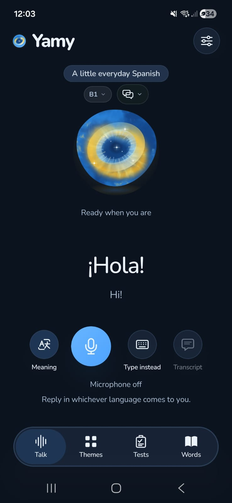
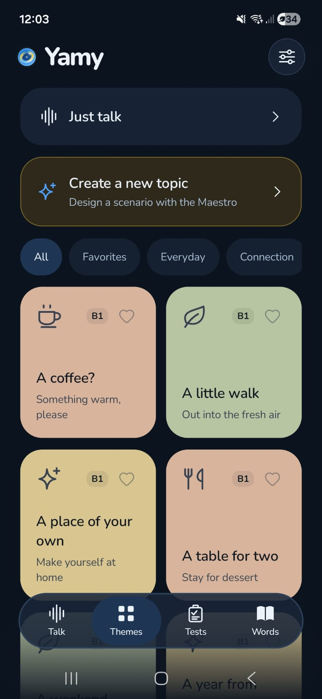
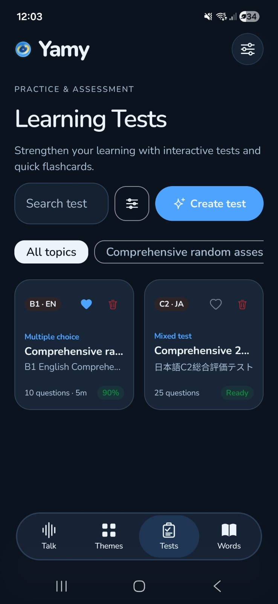
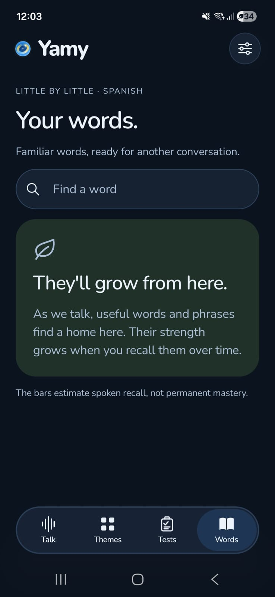
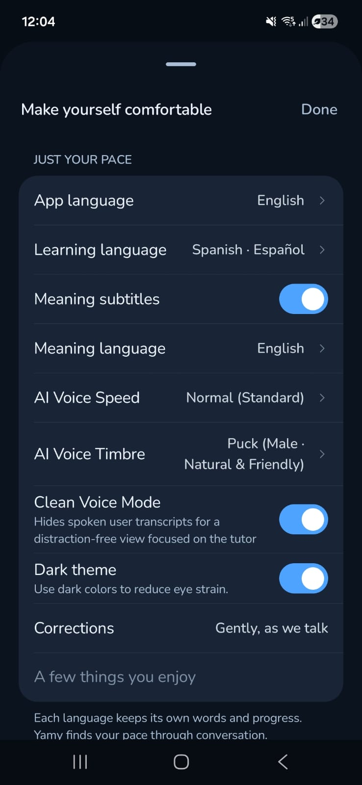

# Manual de usuario de Yamy

**Yamy** te ayuda a aprender un idioma **hablando**. Esta guía recorre el primer uso y cada pestaña de la aplicación.

## Primer uso

1. **Elige tus idiomas.** El idioma que practicas y el idioma en que quieres leer los significados.
2. **Concede el permiso de IA.** Con tu permiso, Yamy envía el audio y el texto de la práctica a Google Gemini. Sin él puedes consultar tu historial y tus palabras guardadas.
3. **Guarda tu clave de API.** En **Ajustes > Cuenta de Google AI Studio** pega tu clave de Gemini (créala gratis en [Google AI Studio](https://aistudio.google.com)). Se cifra en el dispositivo con Android Keystore y nunca se incluye en las copias de seguridad.
4. **Permite el micrófono** cuando la aplicación lo solicite.

## Hablar

- Pulsa el botón del **micrófono** para empezar. La esfera saluda primero en el idioma que practicas.
- Habla con naturalidad: el audio se transmite de forma continua y la IA detecta cuándo terminas de hablar.
- **Significado**: muestra la traducción de lo que dice la IA en tu idioma de lectura.
- **Escribir**: escribe tu respuesta ("Dilo a tu manera") sin cortar la conversación de voz.
- **Transcripción**: muestra u oculta el texto de la conversación.
- Puedes responder en el idioma que te salga; la IA te guía manteniendo la situación.

 

## Temas

- **Solo hablar**: conversación libre.
- **Crear un tema nuevo**: describe una situación y el Maestro diseña el escenario a medida.
- Filtra por categorías (*Todos, Favoritos, Día a día, Conexión...*) y marca favoritos con el corazón.
- Cada tarjeta indica el nivel MCER (A1 a C2). La IA mantiene su papel y adapta el vocabulario, la gramática y la velocidad a ese nivel.

 

## Tests

- **Crear test** genera una evaluación a partir de un tema o de tu práctica.
- Tipos de pregunta: opción múltiple (4 opciones), banco de palabras, comprensión lectora, corrección de frases y expresión oral con micrófono.
- Al terminar ves tu resultado y la explicación detallada de cada respuesta.

 

## Palabras

- Las palabras y expresiones útiles de tus conversaciones se guardan aquí.
- **Buscar una palabra** filtra tu vocabulario.
- Las **barras de recuerdo** estiman cuánto recuerdas cada palabra al usarla en conversaciones posteriores.

 

## Ajustes

- **Idioma de la app** e **idioma de aprendizaje**.
- **Subtítulos de significado** e idioma de los significados.
- **Velocidad** y **timbre de voz** de la IA.
- **Modo voz limpia**: oculta tu transcripción para centrarte en la esfera y la voz del tutor.
- **Tema oscuro**.
- **Correcciones**: modo educación (una microcorrección por turno) o modo conversación (inmersión total, correcciones al final).
- **Copia de seguridad**: exporta e importa conversaciones y progreso (nunca incluye tu clave).

 

## Privacidad

- Conversaciones, palabras y progreso se guardan exclusivamente en tu teléfono.
- El audio y el texto de la práctica se envían a Google Gemini mientras practicas; Yamy no guarda el audio sin procesar.
- El consumo de tu clave se consulta directamente en tu panel de Google AI Studio.

## Problemas frecuentes

| Mensaje | Solución |
| :--- | :--- |
| "Añade tu clave de API en Ajustes para empezar." | Guarda tu clave en **Ajustes > Cuenta de Google AI Studio**. |
| "Tu clave de API no fue aceptada." | Revisa que la clave esté copiada completa y activa en Google AI Studio. |
| "Esta clave de API puede no tener acceso al modelo solicitado." | Comprueba que tu proyecto de Google AI Studio tenga acceso a los modelos Gemini usados. |
| La IA no te oye | Revisa el permiso de micrófono del sistema y que el micrófono no esté silenciado en la aplicación. |

¿Otro problema? Abre un issue en https://github.com/KelmerOC/Yamy/issues.
